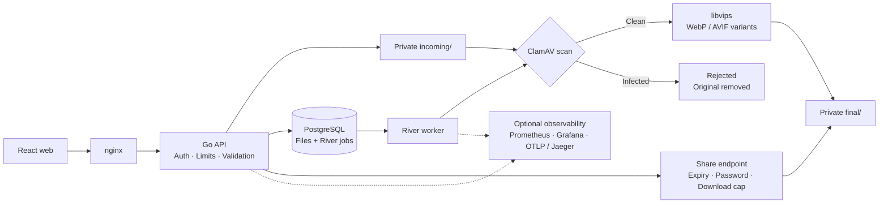

# SafeDrop

**Upload. Scan. Share with an expiry.**

   

.gif>)

Stream JPEG, PNG, WebP, and HEIC images through virus scanning and background conversion, then share them with expiring links. Built with Go, React, PostgreSQL, River, libvips, and ClamAV.

## Architecture

Lifecycle: `uploaded -> scanning -> processing -> ready | rejected`.
Validation and native conversion use disk files; storage streams without buffering whole files in Go memory. Only passing files reach final/. Jobs retry with backoff, check status for idempotency, and reject exhausted failures.

## Setup with Docker Compose

Install Docker with Linux containers and Compose v2 supporting optional env files
and dependencies. Copy `.env.example` to `.env` and set JWT_SECRET to a secure
random secret of at least 32 bytes. Default storage is a named local volume.
From the repository root, start the entire project with one command:

~~~sh
make up
~~~

Without Make, use docker compose up --build -d --wait --wait-timeout 300.
This builds and starts web, API, worker, PostgreSQL, and ClamAV. A one-shot
migrate service applies goose then River migrations before API/worker start.
Open http://localhost:3001 (or WEB_PORT from .env). The browser uses nginx's
same-origin API proxy, so changing API_PORT does not break the frontend.
The existing .env and named volumes are preserved.

Use make ps to check services, make logs to follow logs, and make down to stop
everything while keeping stored data. First startup may take several minutes
for images and ClamAV signatures. /healthz is API liveness, not dependency
readiness. docker compose down -v deletes named volumes and their data.
For S3 mode, set STORAGE_BACKEND=s3 and STORAGE_* credentials/bucket, then run
`docker compose --profile s3 up --build -d`. Provision the private bucket before
uploading. S3_IMAGE is swappable; adjust its command/healthcheck for that server.
Compose uses COMPOSE_STORAGE_ENDPOINT for container DNS.

## Environment variables

[.env.example](.env.example) lists defaults. Compose reads `.env`; Go binaries
read exported variables. Compose overrides addresses intended for host tools.

| Variables | Purpose / defaults |
| --- | --- |
| JWT_SECRET | Required with a database; random secret of at least 32 bytes. |
| DATABASE_URL / COMPOSE_DATABASE_URL | Host / container PostgreSQL DSN; Compose uses the latter. |
| HTTP_ADDR / API_PORT | Host listener :8080 / Compose host port 8080. |
| STORAGE_BACKEND / STORAGE_LOCAL_ROOT | local or s3; host ./data, Compose /data. |
| STORAGE_ENDPOINT / COMPOSE_STORAGE_ENDPOINT | Host / container S3-compatible endpoint. |
| STORAGE_BUCKET / STORAGE_REGION | safedrop / us-east-1. |
| STORAGE_ACCESS_KEY_ID / STORAGE_SECRET_ACCESS_KEY | S3 credentials; change example values. |
| STORAGE_SESSION_TOKEN / STORAGE_FORCE_PATH_STYLE | Optional temporary credential token / true. |
| CLAMD_ADDRESS / CLAMD_TIMEOUT | Host localhost:3310 / 30s; Compose uses clamd:3310. |
| MIN_UPLOAD_BYTES / MAX_UPLOAD_BYTES / MAX_IMAGE_PIXELS | 1 / 26214400 (25 MiB) / 20000000. |
| UPLOAD_TEMP_DIR / IMAGE_OUTPUT_AVIF | Temporary disk directory / false (WebP default). |
| UPLOAD_RATE_WINDOW / UPLOAD_RATE_PER_USER / UPLOAD_RATE_PER_IP | 1m / 20 / 20; three concurrent uploads per user. |
| DAILY_UPLOAD_BYTES | 1073741824 (1 GiB) per user, recorded in PostgreSQL. |
| RATE_LIMIT_REQUESTS_PER_SECOND / RATE_LIMIT_BURST | Other endpoints: 5 / 10 per IP. |
| TURNSTILE_SECRET / TURNSTILE_HOSTNAME | Optional registration challenge secret / expected hostname. |
| SHARE_PRESIGN_GET | false; optional short-lived redirects for unlimited links. |
| WORKER_CONCURRENCY / WORKER_JOB_TIMEOUT | 2 / 1m. |
| WORKER_CPUS / WORKER_MEMORY / WORKER_GO_MEMORY_LIMIT | Compose: 1.0 / 512m / 384MiB. |
| TRUSTED_PROXY_CIDRS | Comma-separated trusted proxy networks; empty trusts none. |
| LOG_LEVEL / SHUTDOWN_TIMEOUT | INFO / 10s. |
| METRICS_ADDR | Host :9090; Compose fixes private API/worker listeners at :9090. |
| OTEL_EXPORTER_OTLP_ENDPOINT / OTEL_SERVICE_NAME | Empty disables export; HTTP base URL / service name per binary. |

## API

Pass `Authorization: Bearer <token>` for authenticated endpoints.

| Method and path | Authentication / behavior |
| --- | --- |
| GET /healthz | Public; 200 liveness response. |
| POST /v1/auth/register | JSON email/password, optional turnstile_token; 201 access token. |
| POST /v1/auth/login | JSON email/password; 200 access token, valid for 15 minutes. |
| POST /v1/files | Bearer; multipart file part; 201 JSON id and status. |
| GET /v1/files?limit=20&cursor=... | Bearer; owned metadata, limit 1–100, opaque next_cursor. |
| GET /v1/files/{id} | Bearer; owned metadata and processing status. |
| DELETE /v1/files/{id} | Bearer; soft delete, 204; foreign/missing files return 404. |
| POST /v1/files/{id}/share | Bearer; owned ready file; JSON expires_at, optional password/max_downloads; 201 link. |
| GET /v1/files/{id}/shares | Bearer; owned share metadata, including revocation IDs. |
| DELETE /v1/shares/{id} | Bearer; revoke an owned share, 204. |
| GET /v1/me/usage | Bearer; daily bytes and rolling-hour upload counts/limits. |
| GET /s/{token} | Link capability; protected links use HTTP Basic password; expired/exhausted links return 410. |

See [upload examples](internal/httpx/UPLOADS.md), [accounts](internal/auth/README.md),
and [share semantics](internal/share/README.md). Upload errors include 400 for
size minimum, 413 for size maximum, 415 for type, 422 for pixels, and 429 with Retry-After.

See [API contract](docs/api.md) for variants, share management, usage, and JSON errors.

## Observability

Run `docker compose --profile observability up` to add Prometheus and Grafana.
Open [Targets](http://localhost:9090/targets): api and worker should show UP after
startup and a 15-second scrape. [Grafana](http://localhost:3000) provisions its
Prometheus datasource; change initial admin/admin credentials on first login.
UIs bind to localhost; default Compose publishes no API/worker metrics ports.
Run `pwsh -File deploy/check-observability.ps1`; add `-Live` to verify targets.
Set OTEL_EXPORTER_OTLP_ENDPOINT=http://jaeger:4318 and start with
`docker compose --profile tracing up` for [Jaeger](http://localhost:16686).
See [PromQL and alerts](docs/observability.md) and [logging/tracing](internal/observability/README.md).

## Security notes

- Keep incoming/ and final/ private; serve only authorized ready files. Terminate TLS at ingress and restrict trusted proxy CIDRs.
- Detect type from bytes, ignore extensions/client MIME, enforce byte/pixel limits, scan before conversion, and strip EXIF.
- Accounts use Argon2id; JWTs expire after 15 minutes. No refresh/revocation API exists; secret rotation invalidates tokens.
- Share tokens contain 128 random bits; only hashes are stored. Password checks and atomic reservations enforce link rules.
- Downloads are private, no-store attachments. Capped links never redirect; presigned URLs can be replayed until expiry.
- Upload windows, API buckets, and concurrency limits are per process; daily quotas are enforced transactionally in PostgreSQL.
- Soft deletion blocks access immediately but does not immediately remove objects; expiry cleanup can remove unreferenced expired files.
- Logs omit credentials, share tokens, and contents; traces export safe attributes. Keep diagnostics private and replace development credentials.

## Development and layout

Use Go 1.25, libvips with CGO (Linux/Docker for native processing), Make, goose,
and sqlc. `make run`, `make worker`, `make test`, and `make lint` run binaries,
tests, and vet. Export DATABASE_URL; `make migrate` applies goose and River schemas.
`sqlc generate` regenerates queries. See [integration tests](docs/integration-tests.md)
for a disposable database and optional live clamd checks; unset test variables skip those checks.
Entry points: cmd/{api,worker,migrate}. internal/: config, db, storage, validate,
scan, imageproc, jobs, share, auth, ratelimit, httpx, observability. SQL lives in
migrations/ and queries/; deploy/ holds monitoring configuration. Keep files under 150 lines and add tests.
## Later

- [tusd](https://tus.github.io/tusd/): resumable uploads; authenticate creation, enforce quotas, and enqueue only completed uploads into incoming/.
- [imgproxy](https://docs.imgproxy.net/usage/signing_url): signed on-demand resizing of ready files; restrict sources/dimensions and preserve the scan boundary.
- CDN: private final/ origin with authorized, expiring access; design cache keys, invalidation, and download accounting before enabling caching.
- [AWS Lambda/S3](https://docs.aws.amazon.com/lambda/latest/dg/with-s3.html): optional redesign; preserve incoming/final isolation, package native dependencies, handle duplicate events idempotently, and avoid recursively processing outputs.
